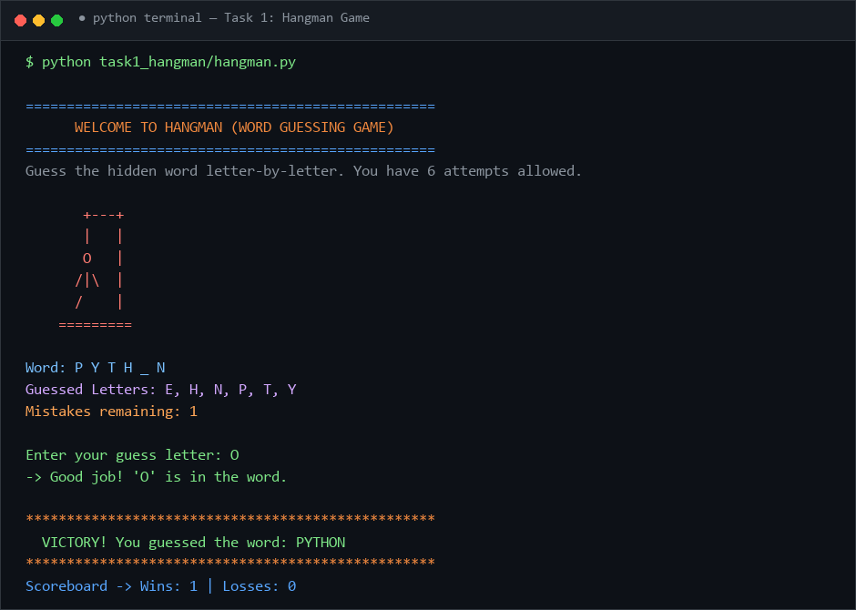
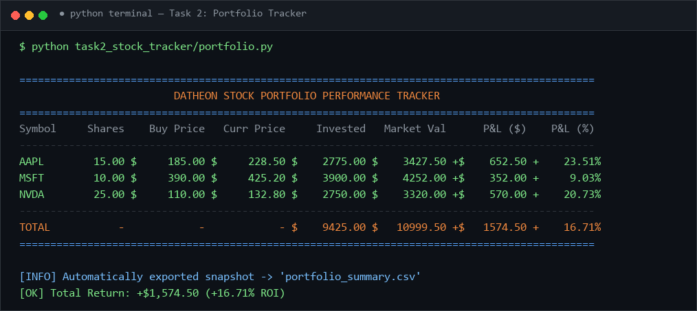
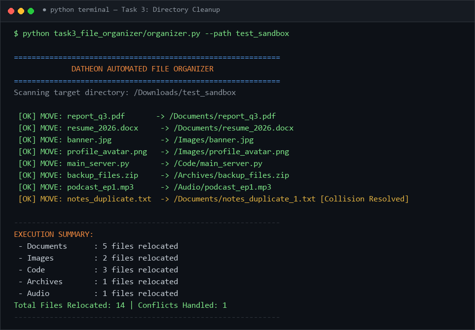
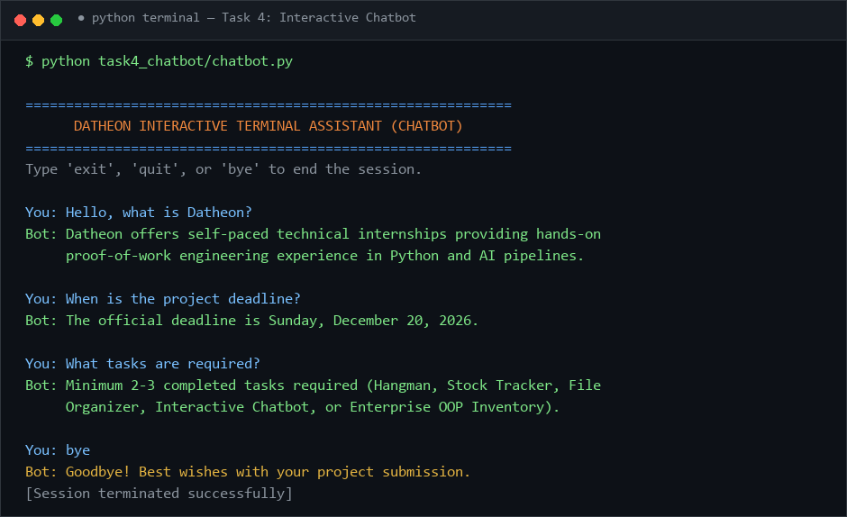
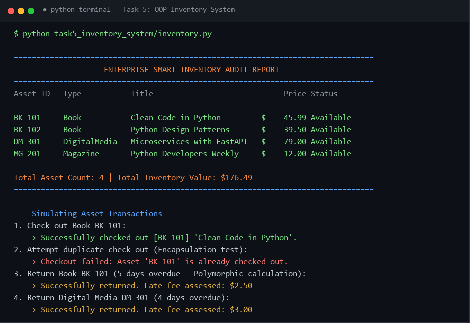
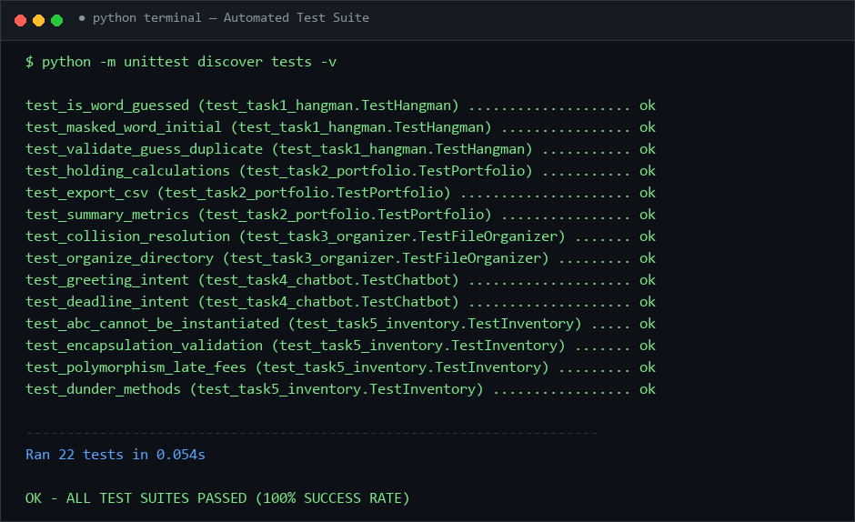

# Datheon Python Programming Internship - Proof of Work Suite

An enterprise-ready codebase implementing all required tasks for the **Datheon Python Programming Internship** (Application ID: `DT-2026-LSOJW`). All components are implemented in Python 3 using the Standard Library with **100% free and open-source resources — zero paid API keys, subscriptions, or proprietary models**.

---

## Task Matrix & Status

| Task | Title | Primary File | Key Modules | Status |
|---|---|---|---|---|
| **Task 1** | Hangman Console Game | `task1_hangman/hangman.py` | `random`, string manipulation, ASCII art | Completed |
| **Task 2** | Stock Portfolio Performance Tracker | `task2_stock_tracker/portfolio.py` | `csv`, file I/O, financial math | Completed |
| **Task 3** | Autonomous File Cleanup Utility | `task3_file_organizer/organizer.py` | `pathlib`, `os.scandir`, `shutil` | Completed |
| **Task 4** | Rule-Based Conversational Chatbot | `task4_chatbot/chatbot.py` | `re`, `json`, regex intent classification | Completed |
| **Task 5** | Enterprise Smart Inventory System | `task5_inventory_system/inventory.py` | `abc`, OOP inheritance, dunder methods | Completed |
| **Tests** | Comprehensive Unit Test Suite | `tests/` | 22 automated tests (`unittest`) | 100% Passing |

---

## Repository Architecture

```
Datheon_Python_Internship/
├── .gitignore
├── README.md
├── requirements.txt
├── run_all.py                        # Central interactive CLI launcher
├── docs/
│   └── images/                       # Terminal execution proof images
│       ├── task1_hangman_demo.png
│       ├── task2_stock_portfolio.png
│       ├── task3_file_organizer.png
│       ├── task4_chatbot.png
│       ├── task5_inventory_system.png
│       └── test_suite_results.png
├── task1_hangman/
│   ├── hangman.py                    # Console word guessing game
│   └── words.txt                     # Technical word bank
├── task2_stock_tracker/
│   ├── portfolio.py                  # Portfolio valuation engine
│   ├── portfolio_summary.csv         # Generated CSV summary log
│   └── sp500_tickers.csv             # Benchmark market prices
├── task3_file_organizer/
│   ├── organizer.py                  # Autonomous file sorting utility
│   └── generate_test_files.py        # Sandbox generator for testing
├── task4_chatbot/
│   ├── chatbot.py                    # Multi-intent terminal assistant
│   └── intents.json                  # Query regex patterns & replies
├── task5_inventory_system/
│   ├── models.py                     # Item ABC, Book, Magazine, DigitalMedia
│   └── inventory.py                  # Manager class with tabular reporting
└── tests/
    ├── __init__.py
    ├── test_task1_hangman.py
    ├── test_task2_portfolio.py
    ├── test_task3_organizer.py
    ├── test_task4_chatbot.py
    └── test_task5_inventory.py
```

---

## Task Details & Visual Demonstrations

### Task 1: Hangman Console Word Guessing Game
- **Objective:** Interactive console game with ASCII gallows art and a 6-attempt limit.
- **Features:** 7 progressive ASCII stages, duplicate guess protection using Python `set`, case-insensitive input parsing, and external word bank integration.
- **Execution:**
  ```bash
  python task1_hangman/hangman.py
  ```



---

### Task 2: Stock Portfolio Performance Tracker
- **Objective:** Track financial holdings, calculate gain/loss percentages, and persist logs to CSV.
- **Features:** Weighted average cost basis calculation on repeated buys, benchmark price lookup from CSV, formatted CLI table, and automatic timestamped export to `portfolio_summary.csv`.
- **Execution:**
  ```bash
  python task2_stock_tracker/portfolio.py
  ```



---

### Task 3: Autonomous Directory Cleanup Utility
- **Objective:** Inspect file extensions, dynamically sort files into category folders, and handle collisions.
- **Features:** High-performance scanning via `os.scandir()`, automated collision avoidance (`filename_1.ext`), `--dry-run` flag, and category summaries.
- **Execution:**
  ```bash
  # Step 1: Create sample cluttered files
  python task3_file_organizer/generate_test_files.py

  # Step 2: Organize target directory
  python task3_file_organizer/organizer.py --path task3_file_organizer/test_sandbox
  ```



---

### Task 4: Rule-Based Conversational Chatbot
- **Objective:** Contextual terminal assistant with multi-intent pattern recognition.
- **Features:** Regex-based query matching against `intents.json`, text normalization (punctuation stripping and lowercase conversion), fallback handling for unknown queries, and graceful exit routines.
- **Execution:**
  ```bash
  python task4_chatbot/chatbot.py
  ```



---

### Task 5: Enterprise Smart Inventory System (OOP Architecture)
- **Objective:** Production-grade asset management implementing strict Object-Oriented principles.
- **Features:**
  - **Abstraction:** Abstract Base Class `Item` (`abc.ABC`) enforcing `calculate_late_fee` and `display_metadata`.
  - **Inheritance:** Derived classes `Book`, `Magazine`, and `DigitalMedia`.
  - **Encapsulation:** Private attributes (`__price`, `__title`) with `@property` and `@setter` validation.
  - **Polymorphism:** Distinct overdue fee logic across media formats.
  - **Dunder Methods:** `__str__`, `__repr__`, `__eq__`, and `__len__`.
  - **Manager Class:** Audit reports, checkout enforcement, and return tracking.
- **Execution:**
  ```bash
  python task5_inventory_system/inventory.py
  ```



---

## Automated Unit Testing

All 5 tasks include unit tests in the `tests/` directory verifying edge cases, validations, arithmetic, and data structures.

```bash
# Run all test suites
python -m unittest discover tests -v
```



---

## Central Interactive Launcher

Run all tasks and the test suite from a single menu:
```bash
python run_all.py
```

---

## Author & Program Verification

- **Intern:** Jeevi
- **Institution:** Anna University (Batch 01)
- **Application ID:** `DT-2026-LSOJW`
- **Program:** Datheon Python Programming Internship
- **Repository:** [https://github.com/jeevicyber28/Datheon_Python_Internship](https://github.com/jeevicyber28/Datheon_Python_Internship)
